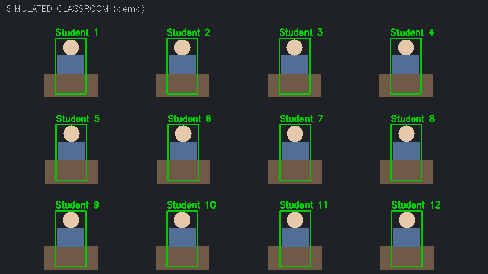

# AI Exam Hall Surveillance System

Real-time CCTV monitoring that flags suspicious behaviour in examination halls and logs timestamped evidence for invigilators.

## Features
- YOLOv10 person + mobile-phone detection (OpenCV pipeline)
- Per-student tracking with IDs
- Rule-based alerts: phone detected, excessive movement, standing up, students too close
- Timestamped events in SQLite + evidence snapshots
- Streamlit dashboard with live feed and alert table
- Dockerized

## Run locally
```bash
python -m venv .venv && source .venv/bin/activate   # Windows: .venv\Scripts\activate
pip install -r requirements.txt
streamlit run app.py
```

## Run with Docker
```bash
docker build -t exam-surveillance .
docker run -p 8501:8501 exam-surveillance
```

## Structure
- `detector.py` – YOLOv10 inference, tracking, alert rules
- `db.py` – SQLite event logging
- `app.py` – Streamlit dashboard

## Limitations
Alerts are heuristic flags for human review, not proof of cheating.

## Classroom demo (no video needed)
`streamlit run app.py` → choose **Classroom demo** → Start. A simulated 12-student classroom plays scripted
events (phone, standing up, leaning to a neighbour, excessive movement) through the same tracker and rule engine
used for real footage. Choose Webcam / Upload video for live YOLOv10 detection.



## Final build: low light + low-power devices
- **Performance profiles** (sidebar): Low power (imgsz 320, detect every 3rd frame), Balanced, Accurate.
- **Low-light enhancement**: dark frames are auto-brightened (gamma + CLAHE); detection confidence is relaxed slightly.
- **Threaded camera capture** removes lag on webcams/RTSP; frames are timestamp-stamped for evidence.
- Windows: double-click `run.bat` or run `python -m streamlit run app.py`.
