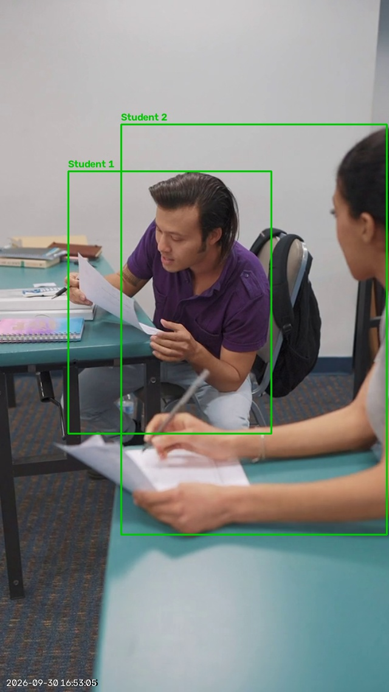
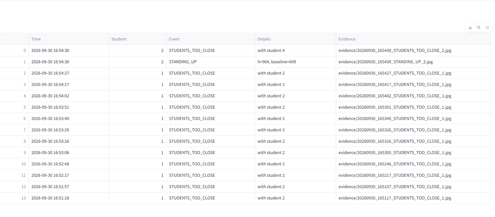
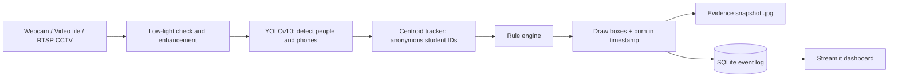

# 🎓 Anti-Cheating Classroom Monitor

**An AI-assisted CCTV system that helps invigilators notice suspicious activity in exam halls, in real time, and keeps timestamped evidence for every alert.**

Built with Python, YOLOv10, OpenCV, Streamlit, SQLite and Docker.

> **The idea in one line:** an invigilator can't watch every desk at once. This system watches all of them, quietly flags moments worth a second look, and saves proof of what it saw. A human always makes the final call.

---

## 📸 What it looks like

### Evidence snapshot, saved automatically when an alert fires
Two students leaning together over their papers triggered a `STUDENTS_TOO_CLOSE` alert. The boxes, the anonymous student IDs and the timestamp are burned into the saved frame, so the evidence stands on its own.



### Alert log, shown live in the dashboard
Every alert is stored with its time, student ID, event type, the reason behind it, and a link to the evidence image.



*Test footage: royalty-free stock video, used only to demonstrate the system.*

---

## 💡 Why I built this

Exam malpractice is hard to catch fairly. A single invigilator has a limited field of view, and CCTV in most halls is only reviewed after something goes wrong, if at all. I wanted to build something in the middle: not a system that *accuses* anyone, but one that acts like a second pair of eyes and says "you might want to look at desk 4 right now."

I also wanted it to actually run on the kind of computers colleges really have, not just on a machine with an expensive GPU.

---

## ✨ What makes this project different

Plenty of projects run an object detector on a video. Here is what I tried to do differently, and why:

**1. Explainable alerts, not a mystery "cheating score."**
Every alert says *why* it fired. For example, `STANDING_UP: h=904, baseline=649` means the student's box is now much taller than their normal seated height. An invigilator or a professor can understand and question that. A black-box percentage can't be questioned.

**2. Each student is compared with themselves.**
Standing up is detected against that student's *own* seated height, not a fixed pixel size. So it works whether the student is near the camera or at the back of the hall, and it adapts to different camera angles.

**3. Built for weak hardware and bad lighting.**
Real exam halls have cheap cameras and dim corners. The app has three performance profiles, skips frames intelligently on slow CPUs, reads the camera in a background thread so lag never builds up, and automatically brightens dark footage before detection.

**4. Privacy-first by design.**
There is no face recognition and no identity tracking. Students are just "Student 1, Student 2…" for the length of a session. The system flags *behaviour*, never *people*.

**5. Evidence you can actually use.**
Alerts aren't just pop-ups that vanish. Each one saves an annotated frame with a burned-in timestamp and a row in a database, so a decision can be reviewed later.

**6. Alert-fatigue control.**
A per-student, per-event cooldown stops the dashboard from spamming the same warning every frame. Invigilators who get 500 alerts learn to ignore all of them.

**7. A built-in simulator.**
There's a scripted classroom demo that runs the *same* tracker and rule engine with no camera and no video. Anyone can clone the repo and see the whole pipeline working in ten seconds, and it doubles as a test bed for tuning rules.

---

## 🧠 How it works



1. **Capture.** Frames come from a webcam, an uploaded video, or a CCTV/IP camera stream.
2. **Low-light enhancement.** If the frame is dark (average brightness below 90 out of 255), it's brightened with gamma correction and CLAHE contrast equalisation. Bright frames are left untouched.
3. **Detection.** YOLOv10 finds people and mobile phones (COCO classes 0 and 67).
4. **Tracking.** A lightweight centroid tracker gives each person a stable ID across frames.
5. **Rules.** The rule engine checks each student's behaviour (see below).
6. **Evidence.** Alerts are drawn on the frame with a timestamp, saved as a `.jpg` in `evidence/`, and logged to SQLite.
7. **Dashboard.** Streamlit shows the live feed, alert banners, the event table and a live FPS/lighting readout.

### The alert rules

| Alert | What triggers it | Default |
|---|---|---|
| `PHONE_DETECTED` | A mobile phone is visible in frame; it's linked to the nearest student | confidence 0.35 |
| `STANDING_UP` | A student's box becomes much taller than their own seated baseline | 1.35× baseline height |
| `EXCESSIVE_MOVEMENT` | A student's path over recent frames is large relative to their body height | threshold 1.5 (slider) |
| `STUDENTS_TOO_CLOSE` | Two students' centres are unusually near each other (possible copying) | 0.6× average box width |

Each (student, alert type) pair has a **10-second cooldown** so the log stays readable.

### Performance profiles

| Profile | Model input size | Detection runs on | Best for |
|---|---|---|---|
| Low power | 320 px | every 3rd frame | old laptops, CPU only |
| Balanced | 480 px | every 2nd frame | most laptops |
| Accurate | 640 px | every frame | better PCs / GPU |

On skipped frames the boxes are still drawn, so the video stays smooth. The movement rule is normalised for frame skipping, so sensitivity stays roughly consistent across profiles.

---

## 🧪 A sample run

I tested the system on a stock clip of students working at desks. In one run it produced:

- Repeated `STUDENTS_TOO_CLOSE` alerts for two students leaning over their papers together, roughly one every 10 seconds because of the cooldown while they stayed close.
- One `STANDING_UP` alert, recorded as `h=904, baseline=649`, showing how the alert compares a student's current height against their own seated baseline.

Every alert has a matching evidence image whose burned-in time equals the time in the log.

I haven't measured accuracy on a labelled dataset yet, so I don't claim precision or recall numbers. See *Limitations* and *Future work* below.

---

## 🚀 Getting started

### Requirements
- Python 3.10 or newer
- A webcam, a video file, or an IP/RTSP camera (or none, to use the simulator)

### Run locally (Windows, macOS or Linux)

```bash
git clone https://github.com/Digvijay-12345/exam-surveillance.git
cd exam-surveillance
python -m pip install -r requirements.txt
python -m streamlit run app.py
```

On Windows you can also double-click `run.bat`.

The app opens at `http://localhost:8501`.

### Using the app

1. Pick a **performance profile** in the sidebar. Use *Low power* on an older machine.
2. Leave **Low-light enhancement** on.
3. Choose an input:
   - **Classroom demo (simulated):** no video needed; a scripted 12-student classroom shows every rule firing.
   - **Webcam:** live detection from your camera.
   - **Upload video:** any `.mp4`, `.avi` or `.mov` clip.
   - **RTSP / CCTV URL:** an IP camera or a phone camera app stream.
4. Click **▶ Start**. The first real-video run downloads the YOLOv10 nano weights (about 5 MB), so it needs internet once.
5. Use the sliders to tune detection confidence and movement sensitivity, and **Clear log** to reset the table.

### Run with Docker

```bash
docker build -t exam-surveillance .
docker run -p 8501:8501 -v "$(pwd)/evidence:/app/evidence" exam-surveillance
```

Then open `http://localhost:8501` and use the simulator or upload a video. Docker on most systems can't reach a laptop webcam directly, so use the local install for webcam demos.

---

## 🗂 Project structure

```
exam-surveillance/
├── app.py              # Streamlit dashboard, input sources, threaded capture
├── detector.py         # YOLOv10 inference, low-light enhancement, tracker, rule engine
├── db.py               # SQLite event logging
├── sim_classroom.py    # Scripted classroom simulator for demos without footage
├── requirements.txt
├── Dockerfile
├── run.bat             # One-click launcher for Windows
├── docs/               # Screenshots used in this README
└── evidence/           # Saved alert snapshots (git-ignored)
```

---

## 🛠 Tech stack

| Layer | Tool |
|---|---|
| Language | Python |
| Detection | YOLOv10 (nano) via Ultralytics |
| Video and image processing | OpenCV |
| Dashboard | Streamlit |
| Storage | SQLite |
| Packaging | Docker |

---

## ⚠️ Limitations (being honest)

- **Alerts are flags, not proof.** They're meant to point a human's attention somewhere. A student stretching, dropping a pen or sharing a desk by design can trigger a false alarm.
- **Hidden phones aren't visible.** A phone in a lap or under a desk can't be seen by any camera-based detector. Small phones far from the camera are also easy to miss, especially on the Low power profile.
- **Camera placement matters a lot.** It works best with a fixed, slightly elevated camera that sees several students at once. Panning or zooming cameras confuse the tracker.
- **The tracker is deliberately simple.** If students cross paths or leave and re-enter the frame, IDs can swap.
- **Very dark scenes stay hard.** Enhancement makes footage visible, but it also amplifies noise.
- **Not yet validated at scale.** I've tested on short clips, not on a labelled exam-hall dataset.
- **Some cheating cues aren't covered yet**, like looking sideways at a neighbour's paper, passing notes or wearing earphones.

---

## 🔒 Ethics and privacy

A monitoring system in a place where students are already under stress needs to be handled carefully. My design choices reflect that:

- No face recognition, no names, no biometric data. IDs are temporary and anonymous.
- The system flags behaviour for **human review**. It never makes a disciplinary decision.
- Real use should have the institution's consent, clear notice to students, and a policy for how long footage and evidence are stored and who can see them.
- Thresholds should be checked on local footage before anyone relies on them, because false accusations are a real harm.

---

## 🔭 Future work

- Head-turn and gaze estimation using a pose model, to catch "looking at a neighbour's paper."
- A proper evaluation: label a set of mock-exam videos and report precision, recall and false alarms per hour.
- A stronger tracker (such as ByteTrack) that survives crossings and occlusion.
- Fine-tuning the detector on real exam-hall footage, including small hand-held phones.
- Instant notifications (email, SMS or a Telegram bot) to the invigilator, and CSV/PDF export of a session report.
- Multi-camera support so an entire hall can be covered from one dashboard.

---

## 👤 Author

**Digvijay**
GitHub: [@Digvijay-12345](https://github.com/Digvijay-12345)

Built as a learning project in computer vision. Feedback and suggestions are welcome, so please open an issue if you have ideas.